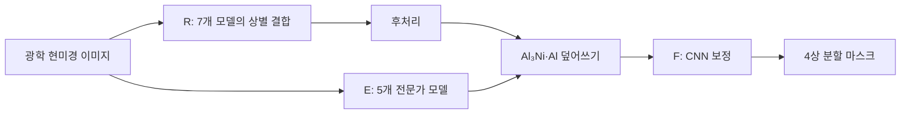
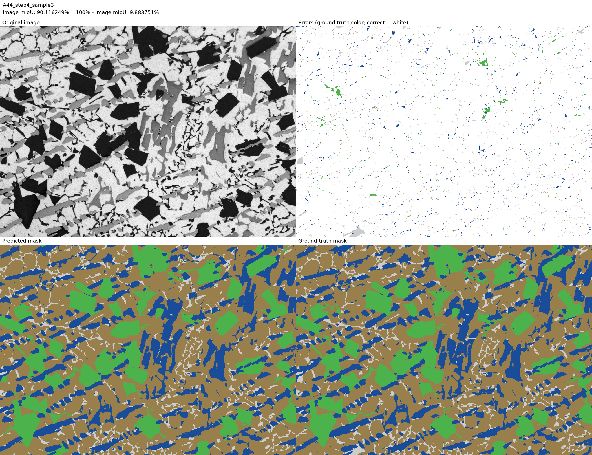
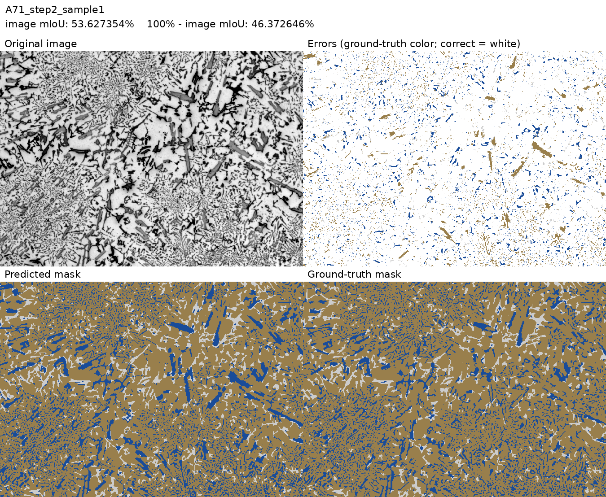

# KoMaP — 알루미늄 합금 미세조직 상 분할

**고탄성 알루미늄 합금 이미지 상 분할 인공지능 모델 개발 대회**의 팀 작업과 개인 서버 실험을 정리한 보관 저장소입니다. 광학 현미경 이미지의 각 픽셀을 **Al, Primary Si, Al₃Ni, Eutectic Si** 네 상으로 분할했습니다.

대회 예선에는 통과하지 못했습니다. 실험 코드, 결과, 제출 자료와 회고를 남깁니다. **학습 가중치는 이 저장소와 Releases에 업로드하지 않았습니다.**

## 최종 선택 모델: Model349 lite13 retuned

최종 제출 모델은 **lite13: R 7개 + E 5개 + F 1개, 총 13개 가중치**입니다. 서버의 100회 시드 탐색 결과와 구분하여 최종 제출본을 기록합니다.

| 항목 | 확인된 결과 |
|---|---|
| 팀 최종 제출 가중치의 valid20 image mIoU | **80.779378%** |
| 개인 서버에서 같은 계열을 재학습한 valid20 image mIoU | **80.471931%** |
| 서버 재학습 모델 valid 20장 추론 | **407.561초**, 장당 평균 **20.378초** |
| 서버 재학습 모델 test 10장 추론 | **223.297초**, 장당 평균 **22.330초** |
| 위 추론시간의 하드웨어 | RTX 4090, 물리 GPU 3·4·5·6; R 분산, E는 GPU 3, F는 CPU |
| 공식 test 점수·순위·탈락 사유 | 확인된 자료 없음 |

제출 점수의 근거는 [팀 최종 모델 문서](team/lhs/final_lite13/1_%EC%86%8C%EC%8A%A4%EC%BD%94%EB%93%9C_%EC%8B%A4%ED%96%89%ED%8C%8C%EC%9D%BC_%EA%B0%9C%EB%B0%9C%ED%99%98%EA%B2%BD/komap_model/README.md), 서버 재학습 점수와 시간의 근거는 [2026-10-14 결과서](server/results/model_results_20261014_1/model_results_20261014_1.md)입니다. 두 점수는 서로 다른 가중치에서 나왔습니다. 위 시간은 서버 재학습 모델의 실측이며, 팀 제출본의 실측 시간으로 해석하지 않습니다.

| 단계 | 구성 | 역할 |
|---|---|---|
| R | ResNet34 2개, EfficientNet-B4 4개, HRNet-W48 1개 | 상별 확률 결합과 후처리 |
| E | EfficientNet-B4 2개, HRNet-W48 3개 | Al₃Ni·Al 예측 보완 |
| F | 3층 CNN 1개 | E 단계에서 잘못 바뀐 Al 픽셀 보정 |



## 자료 찾기

| 경로 | 내용 |
|---|---|
| [실험 결과 색인](docs/RESULTS.md) | 서버 결과서 전체와 주요 실험 흐름, 지표 차이 |
| [실험 코드 색인](docs/EXPERIMENTS.md) | 서버 실험별 README와 소스 경로 |
| [최종 제출 자료](team/lhs/final_lite13/) | 최종 학습·추론 코드, 환경, 모델링 결과서 PDF, 제출 마스크 ZIP |
| [서버 결과](server/results/) | 결과 MD, CSV·JSON 지표, 소스 스냅샷 |
| [서버 보고서](server/reports/) | Fusion805 모델링 결과서, 그림·표 생성 코드와 근거 |
| [팀 저장소 자료](team/) | CNUKoMaP의 6개 비어 있지 않은 저장소 스냅샷 |
| [회고](docs/RETROSPECTIVE.md) | 확인된 사실, 한계와 다음 실험에서 바꿀 점 |
| [재현 안내](docs/REPRODUCTION.md) | conda komap 환경, 가중치 제외 범위, 원본 경로 설명 |
| [보관 범위·출처](docs/ARCHIVE_SCOPE.md) | 복사 기준, 원본 커밋과 해시, 제외 파일 목록 |
| [그림·문서 다운로드](https://github.com/sangpil0104/komap/releases/tag/archive-materials-20261022) | 비교 그림·대용량 보고서·데이터, 가중치 제외 |

이미지와 큰 문서는 Releases에서 해시 검증 후 원래 경로로 복원합니다.

```bash
git clone https://github.com/sangpil0104/komap.git
cd komap
python tools/restore_assets.py --list
python tools/restore_assets.py --prefix server/results/model_results_20261014_1/
```

전체 복원은 `python tools/restore_assets.py --all`을 실행합니다. 학습은 자동으로 실행되지 않습니다.

## 평가 기준과 해석

이미지마다 네 클래스의 IoU를 평균하고, 그 값을 valid 20장에 대해 동일 비중으로 평균합니다. 정답과 예측에 모두 없는 클래스의 IoU는 **0**입니다. 예를 들어 세 클래스의 IoU가 모두 0.8이고 나머지 클래스가 없다면 그 이미지 점수는 `(0.8 + 0.8 + 0.8 + 0) / 4 = 60%`입니다.

valid는 일부 체크포인트 선택과 결합 비율 조정에도 사용했습니다. 따라서 valid 점수를 독립적인 test 성능으로 해석하지 않습니다. 일부 초기 결과는 **빈 클래스 IoU=1**을 사용했으므로 최종 기준 점수와 직접 비교하지 않습니다. 원본 문서는 당시 기록 그대로 보존했습니다.

추론시간에는 프로세스 시작, 모델 로딩, 전처리, R/E/F 계산, 후처리와 결과 저장이 포함됩니다. 학습·채점·보고서 생성은 제외하며 별도 warm-up 없이 측정했습니다. 장당 시간은 전체 처리시간을 이미지 수로 나눈 평균입니다.

## 검증 비교 예시

서버 재학습 모델의 예측입니다. 좌상은 원본, 우상은 틀린 픽셀의 정답색(맞은 픽셀은 흰색), 좌하는 예측, 우하는 정답입니다. 각 그림에 image mIoU와 100%−image mIoU를 표시했습니다.





## 출처 및 자료

팀 GitHub 자료, 팀별 기여와 외부 코드의 원래 출처·라이선스는 [보관 범위](docs/ARCHIVE_SCOPE.md)에 기록했습니다.

## Dear my Team

충남대 인공지능학과 우리팀 이태호, 이현석, 백성현 수고했고, 고생 많았어용
