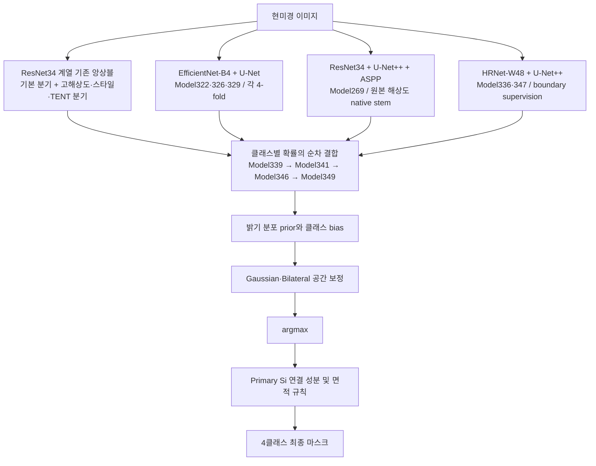

# Model349 결과 및 상세 모델 구조 보고서

작성일: 2026-10-07 (한국 시간 기준)

**Model349의 로컬 재현 성능은 validation 20장에 대한 image mIoU 80.068799%이다.** Model349는 ResNet34, EfficientNet-B4, HRNet-W48 기반 분할 네트워크의 예측 확률을 클래스별로 순차 결합하고, 영상 밝기 통계와 공간 후처리를 적용하는 앙상블 시스템이다. 이 문서는 해당 실행의 결과 JSON, 실제 실행 소스 스냅샷, 저장된 학습 인자를 근거로 작성했다.

본 보고서의 대상은 `model349_train_route_v2` 실행이다. 기존 결과 보고서는 [Model349 결과](model_results_0930_1/model_results_0930_1.md), 수치 원본은 [metrics.json](model_results_0930_1/metrics.json)이다. IDE에서 열려 있던 `model_results_1006_4`는 Model364 결과이며 본 보고서의 대상과 다르다.

**1. 결과와 평가 기준**

| 항목 | 값 |
|---|---:|
| 평가 이미지 수 | 20장 |
| 학습 데이터 수 | 70장 |
| 클래스 수 | 4 |
| Validation image mIoU | **80.068799%** |
| 100% − image mIoU | 19.931201% |
| 정답과 예측에 모두 없는 클래스의 IoU | 0 |

`100% − image mIoU`는 지표의 보수값이며, 오분류 픽셀의 비율을 뜻하지 않는다.

평가 지표는 각 이미지에서 네 클래스 IoU를 동일 가중치로 평균한 뒤, 20장에 대해 다시 동일 가중치로 평균한다.

$$
\operatorname{IoU}_{i,c}=\begin{cases}
\dfrac{TP_{i,c}}{TP_{i,c}+FP_{i,c}+FN_{i,c}},&TP_{i,c}+FP_{i,c}+FN_{i,c}>0,\\
0,&TP_{i,c}+FP_{i,c}+FN_{i,c}=0,
\end{cases}
$$

$$
\operatorname{image\ mIoU}=\frac{1}{20}\sum_{i=1}^{20}\left(\frac{1}{4}\sum_{c=1}^{4}\operatorname{IoU}_{i,c}\right).
$$

클래스별 값 역시 각 이미지에서 계산한 클래스 IoU를 20장 평균한 값이다.

| 클래스 | 이미지별 IoU의 평균 |
|---|---:|
| Al3Ni | 76.839582% |
| Primary Si | 87.101137% |
| Al | 94.363896% |
| Eutectic Si | 61.970580% |

Al의 IoU가 가장 높고 Eutectic Si가 가장 낮다. 이 결과에서 개선 여지가 가장 크게 남은 클래스는 Eutectic Si이다. 다만 낮은 점수의 원인을 구조만으로 확정할 수는 없으며, 아래 개별 비교 이미지와 함께 해석해야 한다.

**2. 실행 식별 및 점수의 범위**

| 구분 | 내용 |
|---|---|
| 실행 ID | `model349_train_20260930T143930_234475Z` |
| 실제 실행 소스 | [source_snapshot](../experiments/model349_train_route_v2/outputs/runs/model349_train_20260930T143930_234475Z/source_snapshot) |
| 실행 단계와 명령 | [pipeline_tasks.json](../experiments/model349_train_route_v2/outputs/runs/model349_train_20260930T143930_234475Z/launcher_snapshot/pipeline_tasks.json) |
| 최종 조합 결과 | [Model349 results.json](../experiments/model349_train_route_v2/outputs/runs/model349_train_20260930T143930_234475Z/outputs/model349_model347_into_346_route/results.json) |
| 공식 결과 산출물 | [model_results_0930_1](model_results_0930_1) |
| 사용 환경 | Conda `komap` |

배포 코드의 [재현 설명 문서][S01]에는 과거 Model349 점수가 **79.9095189%**로 기록되어 있다. 이 문서에서 상세히 설명하는 **80.068799%는 현재 저장된 로컬 재학습·조합 탐색 실행의 점수**이다. 재학습과 중간 모델 선택 정책, 조합 재탐색에 따라 결과가 달라질 수 있으므로 두 점수를 같은 실행의 값으로 혼용하면 안 된다. 과거 점수는 배포 문서의 기록이며, 여기서 그 당시 마스크를 다시 평가한 값은 아니다.

`model_results_0929_349`의 끝 번호 349도 모델 ID로 해석하면 안 된다. 해당 폴더는 `EH0_geometric`라는 별도 HRNet 추론 실험 결과이다.

**3. 전체 모델 구성**



Model349라는 번호는 새로운 단일 신경망 클래스를 의미하지 않는다. 여러 학습된 모델과 확률 결합 설정, 입력 전처리, 추론 증강, 후처리를 합친 최종 파이프라인의 실험 ID이다. 보고서의 구조 설명에는 이 전체 구성이 포함되어야 한다.

| 구성 요소 | 네트워크 | 최종 조합에서의 역할 |
|---|---|---|
| 기존 기본 확률 | ResNet34 기반 compact U-Net++ 및 residual ASPP 계열 | 여러 분기와 영상 통계 라우팅으로 기본 확률 생성 |
| Model269 | ResNet34 + compact U-Net++ + TeamResidualASPP + stride-1 native stem | Eutectic Si 확률 제공 |
| Model322 | EfficientNet-B4 + SMP U-Net, 4-fold | Al 확률 제공 |
| Model326 | EfficientNet-B4 + SMP U-Net, 4-fold | Primary Si·Al₃Ni 확률을 초기 결합 단계에 제공 |
| Model329 | EfficientNet-B4 + SMP U-Net, 4-fold | Primary Si·Al₃Ni 확률을 후속 단계에서 보완 |
| Model336 | HRNet-W48 + SMP U-Net++ | Primary Si·Al·Eutectic Si 확률을 보완 |
| Model347 | Model336을 클래스 가중 CE로 fine-tuning한 동일 구조 | 마지막 단계에서 Al 확률을 보완 |

표의 역할은 실제로 선택된 클래스별 결합 계수를 뜻한다. 이는 각 모델이 해당 클래스만 출력하거나, 각 구성 요소의 독립적인 성능 기여가 실험으로 분리·입증되었다는 뜻은 아니다. 모든 네트워크는 네 클래스 출력을 생성한다.

**4. ResNet34 기반 compact U-Net++와 residual ASPP**

기존 계열은 torchvision ResNet34를 encoder로 사용하고, 프로젝트에서 구현한 compact nested U-Net++ decoder를 연결한다. HRNet 계열의 SMP U-Net++와는 구현이 다르다. 구현 근거는 [UNetPlusPlusResNet34][S02], [ASPPUNetPP 및 ResidualASPP][S03]이다.

입력이 `B×3×H×W`일 때 encoder의 주요 특징은 다음과 같다. 크기는 H와 W가 32의 배수일 때의 대표적인 값이며, decoder는 실제 skip 특징 크기에 맞춰 보간한다.

| 특징 | 경로 | 채널 | 공간 크기 |
|---|---|---:|---|
| x0,0 | ResNet stem | 64 | H/2 × W/2 |
| x1,0 | MaxPool → layer1 | 64 | H/4 × W/4 |
| x2,0 | layer2 | 128 | H/8 × W/8 |
| x3,0 | layer3 | 256 | H/16 × W/16 |
| x4,0 | layer4 → ASPP | 512 | H/32 × W/32 |

Decoder는 상위의 낮은 해상도 특징을 bilinear upsampling하고, 같은 해상도의 encoder 특징과 앞서 생성한 decoder 특징을 채널 방향으로 연결한다. 실제 노드는 `x3_1, x2_1, x1_1, x0_1`, 이어 `x2_2, x1_2, x0_2`, 마지막 `x1_3, x0_3`이다. 같은 해상도에서 여러 깊이의 특징을 재사용하는 중첩 연결이 핵심이다.

최종 `x0_3`의 64채널 특징과 stem의 64채널 특징을 각각 입력 해상도로 보간하고 연결한다. 128채널 입력을 head의 32채널 특징으로 변환한 후 `1×1 convolution`으로 네 클래스 logits를 출력한다.

RGB 기반 ASPP 계열은 가장 깊은 512채널 특징에 다음 다섯 분기를 적용한다.

| 분기 | 연산 | 출력 채널 |
|---|---|---:|
| 1 | 1×1 convolution + BN + ReLU | 128 |
| 2 | 3×3 convolution, dilation 6 + BN + ReLU | 128 |
| 3 | 3×3 convolution, dilation 12 + BN + ReLU | 128 |
| 4 | 3×3 convolution, dilation 18 + BN + ReLU | 128 |
| 5 | Global average pooling → 1×1 convolution + BN + ReLU → 보간 | 128 |

640채널로 연결한 결과를 `1×1 convolution + BN + ReLU`로 512채널에 투영한다. 잔차 출력은 다음과 같으며, 학습 가능한 계수 s는 0으로 초기화된다.

$$F_{out}=F_{in}+s\cdot\mathrm{Project}(\mathrm{Concat}(F_1,F_2,F_3,F_4,F_5)).$$

이 초기화는 ASPP 분기를 추가한 시점에 기존 경로의 출력을 유지하도록 한다.

**5. 기존 기본 확률 앙상블의 생성**

[실행 레시피][S04]와 [Model183 캐시 생성 코드][S05]를 따라가면, 기본 확률에는 다음 요소가 포함된다.

- 기본 세 분기: Model97, Model98, Model109. 앞의 두 모델은 ResNet34 compact U-Net++ 계열이고, Model109는 residual ASPP를 추가한 계열이다.
- Pairwise 분기: `restart61_pairwise_margin/best.pt`.
- 고해상도 분기 후보: restart51, Model109, restart59(seed456), restart61(pairwise), Model123(EMA).
- 고해상도 분기에서 원본 이미지와 밝기를 표준화한 이미지의 추론을 결합한다.
- 768 타일과 1024 타일 추론 결과를 0.8 : 0.2로 결합한다. 대응 stride는 각각 576, 768이다.
- 해당 고해상도 추론은 D4의 8개 회전·반사 변환과 Gaussian 타일 가중치를 사용한다.

기본 세 분기의 클래스별 가중치 행렬은 다음과 같다. 열 순서는 Model97, Model98, Model109이다.

$$W=\begin{bmatrix}
0.35&0.40&0.25\\
0.25&0.35&0.40\\
0.50&0.30&0.20\\
0.25&0.55&0.20
\end{bmatrix}.$$

행 순서는 Al₃Ni, Primary Si, Al, Eutectic Si이다. 이를 고해상도·pairwise 분기와 결합한 뒤 정규화한다. 개략적으로 클래스 c의 정규화 전 점수는 다음과 같다.

$$U_c=(1-w_h-w_p)\sum_{m=1}^{3}W_{c,m}P_{m,c}+w_hP_{high,c}+w_pP_{pair,c}.$$

`w_h`, `w_p`, 스타일 결합 비율, 일부 bias는 영상 평균 밝기와 표준편차에 따라 정해진다. 예를 들어 평균 밝기 159 이상 161 미만에서는 `high_weight=0.70`, `pair_weight=0.05`, `style_weight=1.0`이다. 일반 경로에서는 평균 밝기 165 미만일 때 고해상도 가중치 0.85, 그 외에는 0.55를 사용한다. 전체 분기 조건은 [route_params][S06]와 [choose_source][S07]가 기준이다.

TENT 적응은 각 이미지에 대해 선택된 체크포인트를 불러와 BatchNorm의 affine 파라미터를 출력 entropy 최소화로 5회 갱신한다. 학습률은 1e-5이며, ASPP global-pooling BN은 저장 통계를 유지한다. 따라서 이 기본 경로에는 추론 시 입력 영상에 대한 파라미터 적응이 존재한다. 정답 마스크를 사용하는 지도학습 단계와 구분해야 한다. 구현은 [adapt_model][S08]이다.

Model183 캐시는 Model181 표현 분기의 Primary Si 확률을 γ=0.4로 혼합한 상태를 저장한다. 후속 라우팅에서는 [undo_model181_primary_blend][S09]로 그 혼합을 역산하여 기본 확률을 복원한 뒤 새로운 전문가를 추가한다. Model181의 γ=0.4를 Model349 최종 결합표에 그대로 추가하면 실제 계산과 달라진다.

**6. Model269: 표현 변환과 원본 해상도 stem**

Model269의 실제 클래스는 `Stride1NativeStemASPP`이다. 앞선 설명에서 단순히 ResNet34–U-Net++–ASPP로 묶을 수 있으나, 재현 가능한 상세 구조에는 **원본 해상도의 추가 stem**을 포함해야 한다. 근거는 [native stem 구현][S10]과 [Model269 학습·추론 코드][S11]이다.

주 경로는 ResNet34 encoder, compact U-Net++ decoder, TeamResidualASPP이다. TeamResidualASPP의 다섯 분기는 다음과 같다.

- 1×1 convolution.
- 3×3 convolution, dilation 2.
- 3×3 convolution, dilation 4.
- 3×3 convolution, dilation 8.
- Global average pooling 분기.

각 분기는 128채널, 연결 결과는 640채널이며 512채널로 투영하는 잔차 구조이다. 이 dilation 설정은 RGB ASPP의 6·12·18과 다르다. [TeamResidualASPP][S12]에 정의되어 있다.

추가 native stem은 입력 해상도를 유지하며 다음과 같이 동작한다.

```text
입력 3×H×W
  → Conv3×3(3→32, stride 1) → BN → ReLU
  → Conv3×3(32→32, stride 1) → BN → ReLU
  → Conv3×3(32→32, 가중치 0 초기화)
  → 기존 segmentation head의 첫 convolution 출력에 더함
  → 이후 BN·ReLU·convolution → 4클래스 logits
```

원본 해상도의 국소 특징을 head에 직접 전달하는 경로이며, 추가 투영 가중치를 0으로 초기화한다. 그 목적은 기존 예측 경로에서 출발하면서 세부 공간 정보를 학습할 수 있도록 하는 것이다. 실제 성능 기여를 수치로 분리한 ablation 결과는 본 보고서에서 새로 산출하지 않았다.

Model269는 Model257에서 이어서 4 epoch 학습한 결과이다. 명시된 scale은 1, 패치는 1024×1024, batch는 2, 이미지당 패치 수는 8이다. encoder·decoder·native 경로의 학습률은 각각 2.5e-6, 7.5e-6, 5e-5이다. `--global-representation`으로 전체 영상의 표현 통계를 사용하고 D4 추론을 적용한다. 학습 시 패치보다 작은 영상은 최소 변 길이를 맞추기 위한 확대가 적용될 수 있다.

**7. Model322·326·329: EfficientNet-B4 + U-Net**

세 모델의 네트워크는 모두 SMP의 `Unet(encoder_name='efficientnet-b4', in_channels=3, classes=4)`이다. Encoder에서 여러 해상도의 특징을 추출하고, U-Net decoder가 upsampling과 대응 encoder skip 특징 결합으로 공간 해상도를 복원한다. 입력과 출력 해상도는 padding 및 최종 복원 처리에 의해 맞춰진다. [B4 모델 생성 및 입력 코드][S13]가 근거이다.

| 항목 | Model322 | Model326 | Model329 |
|---|---|---|---|
| 입력 채널 | 정규화 grayscale 3회 복제 | Raw / Z-score / CDF | Raw / Z-score / CDF |
| 크기 설정 | 3배 확대 | 3배 확대 | 영상 너비 4000 |
| 통계 범위 | grayscale ImageNet 모드 | 전체 영상 통계 | 전체 영상 통계 |
| 이미지 샘플링 | 면적 비례 | 면적 비례 | 이미지 균등 |
| 학습 패치 | 1536×1536 | 1536×1536 | 1536×1536 |
| 모델 수 | 4-fold | 4-fold | 4-fold |

Raw/Z-score/CDF의 세 채널은 동일한 grayscale 영상으로부터 생성한다. g를 [0,1] 밝기, μ와 σ를 전체 영상 통계, CDF를 해당 영상의 밝기 누적분포라고 하면 B4 표현은 다음과 같다.

$$X=\left[\frac{g-0.5}{0.25},\ \frac{\operatorname{clip}((g-\mu)/(\sigma+10^{-6}),-4,4)}{3},\ \frac{\operatorname{CDF}(g)-0.5}{0.288675}\right].$$

Raw는 절대 밝기, Z-score는 영상 내 평균 대비 상대 밝기, CDF는 밝기 순위 정보를 제공한다. Model326·329의 학습 표현은 전체 영상 통계를 구한 뒤 패치를 추출하는 방식이다. ResNet 표현 계열에도 raw/z/CDF를 사용하지만 CDF 구현의 세부 차이가 있으므로 B4 함수를 그대로 대체해 재현하면 안 된다.

시편 그룹 단위로 나눈 네 fold를 각 모델 종류에 사용한다. validation 예측은 각 종류의 네 fold 확률을 평균한다. B4 계열만 총 **12개의 학습 체크포인트**가 사용된다. 각 fold의 예측을 평균한 결과와 학습 데이터에 대한 out-of-fold 예측은 서로 구분해야 한다. 최종 80.068799%는 validation 20장의 앙상블 결과이다.

공통 학습 설정은 다음과 같다.

| 항목 | 설정 |
|---|---|
| 초기화 | ImageNet 사전학습 encoder |
| Fold당 iteration | 16,000 |
| Batch size / gradient accumulation | 2 / 1 |
| Optimizer | AdamW |
| 초기 learning rate | 3e-4 |
| Weight decay | 0.01 |
| Schedule | 300 step warm-up을 곱한 cosine schedule |
| 손실 | CE + Dice, Dice 계수 1.0 |
| Lovasz / clDice | 해당 실행에서 사용하지 않음 |
| EMA | 해당 실행에서 사용하지 않음 |
| Seed | 각 fold 인자에 0 기록 |
| 추론 체크포인트 | 각 fold의 last.pt |

B4 추론은 각 모델의 크기 설정으로 전체 영상을 조정하고, 32의 배수가 되도록 padding한 뒤 D4의 8개 회전·반사 변환을 사용한다. 변환을 되돌린 softmax 확률을 평균하고 원래 해상도로 복원한 후 fold 간 평균을 구한다. 이 B4 추론 경로는 전체 영상 forward를 사용한다. HRNet의 sliding-window 추론 방식과 구분한다. [B4 추론 코드][S13], [학습 코드][S14], 각 fold의 `args.json`에 근거한다.

**8. Model336·347: HRNet-W48 + SMP U-Net++**

두 모델은 SMP의 `UnetPlusPlus(encoder_name='tu-hrnet_w48', in_channels=3, classes=4)`이다. HRNet-W48은 여러 공간 해상도의 특징을 유지·교환하는 encoder이며, U-Net++ decoder의 중첩 skip 연결로 특징을 결합한다. HRNet이라는 이름 때문에 최종 출력 head까지 HRNet 원형이라고 기술하면 실제 구성과 달라진다. 네트워크 생성은 [HRNet 모델 코드][S15]에 있다.

입력은 RGB로 읽은 영상을 ImageNet 통계로 정규화한 3채널 영상이다. 학습은 2배 입력 scale과 512×512 패치를 사용한다. Decoder의 마지막 특징에서 두 head가 생성된다.

- Segmentation head: 네 클래스 logits를 출력하며 학습과 추론에 사용한다.
- Boundary head: 3×3 convolution으로 1채널 경계 logits를 출력하며 학습에 사용한다.

Boundary target은 주변 3×3 영역에 둘 이상의 클래스가 존재하는 픽셀로 만든다. 이 경계 supervision은 클래스와 무관한 경계 band를 학습한다. 최종 추론 확률에는 boundary head 출력을 직접 더하지 않는다.

$$L=0.5L_{CE}+0.5L_{Dice}+1.0L_{boundary},$$

$$L_{boundary}=L_{weighted\ BCE}+L_{boundary\ Dice}.$$

Boundary BCE의 positive weight는 해당 batch의 경계·비경계 픽셀 비율로 정한다. 구체적인 구현은 [손실 함수][S16]이다.

| 설정 | Model336 | Model347 |
|---|---|---|
| 시작점 | ImageNet encoder 초기화 | Model336의 last.pt |
| Epoch | 70 | 12 |
| Batch / gradient accumulation | 4 / 2 | 4 / 2 |
| 이미지당 학습 샘플 | 12 | 12 |
| Optimizer | AdamW | AdamW |
| Decoder 및 head LR | 3e-4 | 1e-4 |
| Encoder LR | 3e-4 | 3e-5 |
| Weight decay | 1e-4 | 1e-4 |
| Schedule | CosineAnnealingLR | CosineAnnealingLR |
| CE 클래스 가중치 | 없음 | inverse-frequency 계수 |
| Seed | 0 | 347 |
| 최종 확률 생성에 사용한 체크포인트 | last.pt | last.pt |

Model347의 CE 가중치는 **팀 클래스 순서** `[Al, Al₃Ni, Primary Si, Eutectic Si]`로 `[0.22906544, 0.49862612, 1.39166570, 1.88064275]`이다. 조합 코드의 클래스 순서 `[Al₃Ni, Primary Si, Al, Eutectic Si]`와 다르므로 반드시 순서를 표시한다. [학습 코드][S17]와 실행 결과의 `args.json`을 대조했다.

HRNet 추론은 원본 영상에서 256×256 타일을 잘라 512×512로 확대한다. 원본 좌표의 overlap은 170, stride는 86이다. 타일 softmax를 원래 타일 크기로 되돌리고 Gaussian window로 중첩 영역을 결합한다. TTA는 **원본·수평반전·수직반전·수평수직반전의 4개**이다. B4 및 일부 ResNet 분기의 D4 8개와 다르다. [HRNet 추론 코드][S18] 및 저장된 `valid_summary.json`에서 확인했다.

**9. 클래스별 확률 결합과 Model349의 정확한 설정**

확률 아카이브는 모두 동일한 클래스 순서 `[Al₃Ni, Primary Si, Al, Eutectic Si]`로 맞춘다. 팀 순서의 확률은 채널 인덱스 `[1,2,0,3]`으로 재배열한다.

기존 확률 P에 전문가 확률 Q의 클래스 c를 결합할 때 다음 연산을 수행한다.

$$\widetilde P_c=(1-\gamma)P_c+\gamma Q_c,\qquad \widetilde P_k=P_k\ (k\ne c),$$

$$P'_k=\frac{\widetilde P_k}{\max(\sum_j\widetilde P_j,10^{-7})}.$$

각 교체 직후 재정규화하기 때문에 다른 클래스의 확률도 변한다. 여러 단계를 단순한 고정 가중 평균으로 합치거나, 표의 계수를 곱하여 최종 가중치를 구하면 실제 구현과 달라진다. 클래스별 계수는 grid search로 선택한 값이며, 이 최종 결합부를 신경망 gating network가 학습하는 구조는 아니다. 기본 확률 생성부에는 앞서 설명한 영상 통계 규칙이 별도로 있다.

| 단계 | Al₃Ni | Primary Si | Al | Eutectic Si |
|---|---|---|---|---|
| Model339 | Model326, γ=0.70 | Model326, γ=1.00 | Model322, γ=0.60 | Model269, γ=0.70 |
| Model341 | Model329, γ=0.50 | Model329, γ=1.00 | 추가 없음 | 추가 없음 |
| Model346 | 추가 없음 | Model336, γ=0.25 | Model336, γ=0.75 | Model336, γ=0.75 |
| **Model349** | 추가 없음 | 추가 없음 | **Model347, γ=0.25** | 추가 없음 |

Model339 내부의 실제 순서는 **Primary Si → Al₃Ni → Eutectic Si → Al**이다. 이후 Model329, Model336, Model347을 순서대로 처리하며, 각 전문가 내부에서는 클래스 인덱스 순으로 0이 아닌 계수를 적용한다. Model349의 추가 전문가 후보는 γ∈{0, 0.25, 0.5, 0.75, 1.0}의 클래스별 조합 625개이며, 선택된 γ347은 `[0,0,0.25,0]`이다.

아래 의사코드는 최종 확률 결합 순서를 나타낸다. `replace`는 해당 클래스 교체와 네 클래스 전체 재정규화를 함께 수행한다.

```python
P = recover_base_probability(model183_entry)
P = replace(P, P326, class_id=1, gamma=1.00)
P = replace(P, P326, class_id=0, gamma=0.70)
P = replace(P, P269, class_id=3, gamma=0.70)
P = replace(P, P322, class_id=2, gamma=0.60)
P = replace(P, P329, class_id=0, gamma=0.50)
P = replace(P, P329, class_id=1, gamma=1.00)
P = replace(P, P336, class_id=1, gamma=0.25)
P = replace(P, P336, class_id=2, gamma=0.75)
P = replace(P, P336, class_id=3, gamma=0.75)
P = replace(P, P347, class_id=2, gamma=0.25)
prediction = spatial_and_statistical_refinement(P, image_statistics)
```

이 코드는 설명용이며 실제 추론 명령은 아니다. 실제 구현 근거는 [Model339 기본 혼합][S19], [Model341][S20], [Model346·349][S21], [replace_classes 및 후처리][S22]이다.

**10. 밝기 통계 보정과 공간 후처리**

최종 마스크는 혼합 확률에 다음 처리를 적용하여 생성한다.

① **클래스별 밝기 prior.** 학습 영상과 정답 마스크에서 구한 클래스별 Z-score 및 percentile/CDF 분포를 사용한다. 기본 prior는 Z-score 기반 항 0.85, CDF 기반 항 0.15의 조합이다. 입력 영상에 대한 혼합 확률의 제곱을 가중치로 사용해 적응형 평균·표준편차도 추정한다. 적응형 차이 항은 Al₃Ni에 적용한다. [prior_terms][S05]에 계산이 정의되어 있다.

② **Log-probability와 bias 보정.** 확률을 `log(max(P, 1e-7))`로 바꾼 후 prior를 더한다. 선택된 설정은 다음과 같다.

| 항목 | 값 |
|---|---:|
| prior에 곱하는 기본 계수 | 0.09 |
| prior_scale | 1.25 |
| beta_scale | 0.80 |
| 추가 Al bias, al_delta | 0.00 |
| 추가 Eutectic Si bias, eut_delta | +0.15 |

Al·Eutectic Si에는 `route_params`가 제공한 영상별 bias도 함께 적용한다. 따라서 Al의 총 bias가 0이거나 Eutectic Si의 총 bias가 언제나 +0.15인 것은 아니다. 일반적으로 Al의 기본 bias는 +0.45이며 Eutectic Si bias와 Al₃Ni의 적응형 beta는 밝기 조건에 따라 달라진다.

③ **경계를 고려한 공간 보정.** 영상 Z-score를 guide로 하는 bilateral 필터를 사용한다. 반경은 2, 즉 5×5 이웃이며, spatial sigma는 1.0, range sigma는 0.60이다.

- Primary Si: `0.50 × Gaussian(logit, sigma=0.50) + 0.50 × Bilateral(logit)`.
- Eutectic Si: `0.75 × 원래 logit + 0.25 × Bilateral(logit)`.
- 나머지 클래스는 이 두 클래스용 공간 필터 교체를 직접 적용하지 않는다.

④ **마스크 결정과 Primary Si 정리.** 보정된 logits의 argmax를 취한다. Primary Si의 연결 성분 중 128픽셀 이하를 제거하고 그 픽셀에서 가장 점수가 높은 다른 클래스에 재할당한다. 정리 후 Primary Si의 전체 면적 비율이 1% 이하이면 남은 Primary Si도 같은 방식으로 재할당한다. 연결 성분은 `scipy.ndimage.label`의 기본 2차원 연결성으로 계산한다. [cleanup_primary][S23]에 구현되어 있다.

이 면적 규칙은 작은 Primary Si 입자를 제거할 수 있으므로 최종 추론 방법의 일부로 명시해야 한다. Boundary head, Gaussian 타일 결합, 최종 logits 공간 필터는 서로 다른 처리이다.

**11. 조합 단계별 성능과 해석**

동일 실행에서 저장된 단계별 validation image mIoU는 다음과 같다.

| 단계 | 변경 | image mIoU | 직전 표 단계 대비 |
|---|---|---:|---:|
| Model339 | B4 및 Model269 전문가의 초기 클래스별 결합 | 79.324244% | — |
| Model341 | Model329 추가 | 79.646709% | +0.322465%p |
| Model346 | Model336 추가 | 80.051787% | +0.405078%p |
| Model349 | Model347의 Al 확률 추가 | 80.068799% | +0.017012%p |

Model349가 Model346 대비 얻은 변화는 **+0.017012%p**이다. Model347은 전체 확률을 동일 가중치로 평균하는 대신 Al 채널만 γ=0.25로 추가하는 방식으로 선택되었다.

저장된 `grouped_cv_vs_model346`는 검증 이미지 20장을 19개 시편 그룹으로 나누고, 각 시편을 제외한 나머지 그룹에서 γ347을 선택한 후 제외한 그룹을 평가한 결과이다. 기록된 평균 변화는 **−0.010368%p**, 그룹 bootstrap 95% 구간은 **[−0.072720, +0.041119]%p**이다. 이 검사는 γ347 선택의 변동성을 살펴보는 보조 분석이다. 선행 모델·기본 조합은 이미 검증셋에 의해 개발·선택되었으므로, 파이프라인 전체를 독립 데이터로 검증한 성능으로 해석할 수 없다.

단계별 차이는 현재 순서로 조합을 추가했을 때의 관측값이다. 각 요소의 인과적인 기여를 분리하려면 해당 요소만 바꾼 통제 실험이 필요하다.

**12. 보고서에서 SOTA로 제시할 때의 서술**

본 문서는 Model349를 보고서의 대표 성능 모델로 기술하기 위한 구조·결과 근거이다. 확인된 80.068799%는 **체크포인트 및 조합 선택에 사용된 validation 20장의 성능**이다. 외부 연구 전체에 대한 공인 SOTA 순위, 독립 test 성능, 저장소 전체 모델 중 최고 성능 여부를 이 문서에서 새로 검증한 것은 아니다.

동일 데이터 분할·지표·검증 조건으로 구성한 비교표에서 최고임을 확인했다면 “본 연구의 비교 대상 중 최고 validation 성능을 보인 Model349”로 표현할 수 있다. SOTA라는 용어를 사용할 경우 비교 대상과 평가 조건을 함께 제시해야 한다. 특히 empty-union 클래스 제외, 다른 데이터 분할, 단일 모델 결과와의 비교는 조건을 명시해야 한다.

보고서에 사용할 수 있는 방법 서술:

> Model349는 입력 표현 및 backbone이 서로 다른 분할 전문가를 결합하는 클래스별 확률 앙상블이다. 기본 ResNet34–compact U-Net++ 앙상블에 residual ASPP, 영상 통계 기반 라우팅 및 고해상도 추론을 적용하고, Raw/Z-score/CDF 표현과 원본 해상도 stem을 사용하는 ResNet34 전문가, 4-fold로 학습한 세 종류의 EfficientNet-B4–U-Net 전문가, 경계 보조 학습을 적용한 HRNet-W48–U-Net++ 전문가를 순차적으로 결합하였다. 각 결합 단계에서는 선택된 클래스 확률을 선형 혼합한 뒤 클래스 전체를 재정규화하였다. 최종 확률에는 밝기 통계 prior, Gaussian 및 bilateral 공간 보정, Primary Si 연결 성분·면적 규칙을 적용하였다.

보고서에 사용할 수 있는 결과 서술:

> Model349는 validation 이미지 20장에서 image mIoU 80.0688%를 기록하였다. 평가는 각 이미지에서 Al₃Ni, Primary Si, Al, Eutectic Si의 IoU를 동일 가중치로 평균한 뒤 전체 이미지에 대해 평균하였으며, 정답과 예측에 모두 없는 클래스의 IoU는 0으로 처리하였다. 클래스별 이미지 평균 IoU는 각각 76.8396%, 87.1011%, 94.3639%, 61.9706%였다. 검증셋은 일부 체크포인트 및 최종 결합 설정 선택에도 사용되었으므로, 보고된 수치는 독립 test 성능과 구분된다.

모델명을 풀어 써야 한다면 “Model349: 클래스별 확률 결합과 공간 보정을 적용한 다중 backbone 분할 앙상블”을 사용할 수 있다. 전체 성능을 단일 ResNet34–U-Net++–ASPP 네트워크의 성능으로 기재하지 않는다.

**13. 이미지별 결과와 기존 비교 이미지**

아래 링크는 기존 결과를 그대로 참조한다. 비교 이미지 배치는 좌상 Original, 우상 Error, 좌하 Prediction, 우하 Ground truth이다. Error에서 맞은 픽셀은 흰색, 틀린 픽셀은 해당 위치의 정답 클래스 색상이다.

| 이미지 | image mIoU | 100% − image mIoU | 비교 이미지 |
|---|---:|---:|---|
| A117_step4_sample2 | 86.8751% | 13.1249% | [보기](model_results_0930_1/valid_mask_comparison/A117_step4_sample2.png) |
| A11_step1_sample4 | 79.0629% | 20.9371% | [보기](model_results_0930_1/valid_mask_comparison/A11_step1_sample4.png) |
| A11_step2_sample4 | 76.9877% | 23.0123% | [보기](model_results_0930_1/valid_mask_comparison/A11_step2_sample4.png) |
| A125_step1_sample4 | 79.4617% | 20.5383% | [보기](model_results_0930_1/valid_mask_comparison/A125_step1_sample4.png) |
| A153_step3_sample3 | 71.9084% | 28.0916% | [보기](model_results_0930_1/valid_mask_comparison/A153_step3_sample3.png) |
| A170_step4_sample3 | 88.6932% | 11.3068% | [보기](model_results_0930_1/valid_mask_comparison/A170_step4_sample3.png) |
| A181_step1_sample1 | 80.0571% | 19.9429% | [보기](model_results_0930_1/valid_mask_comparison/A181_step1_sample1.png) |
| A186_step2_sample2 | 82.2767% | 17.7233% | [보기](model_results_0930_1/valid_mask_comparison/A186_step2_sample2.png) |
| A191_step4_sample3 | 81.8919% | 18.1081% | [보기](model_results_0930_1/valid_mask_comparison/A191_step4_sample3.png) |
| A40_step3_sample3 | 82.2009% | 17.7991% | [보기](model_results_0930_1/valid_mask_comparison/A40_step3_sample3.png) |
| A42_step2_sample4 | 82.7153% | 17.2847% | [보기](model_results_0930_1/valid_mask_comparison/A42_step2_sample4.png) |
| A44_step4_sample3 | 90.4068% | 9.5932% | [보기](model_results_0930_1/valid_mask_comparison/A44_step4_sample3.png) |
| A55_step2_sample1 | 81.8070% | 18.1930% | [보기](model_results_0930_1/valid_mask_comparison/A55_step2_sample1.png) |
| A59_step3_sample1 | 82.5611% | 17.4389% | [보기](model_results_0930_1/valid_mask_comparison/A59_step3_sample1.png) |
| A63_step1_sample4 | 83.9091% | 16.0909% | [보기](model_results_0930_1/valid_mask_comparison/A63_step1_sample4.png) |
| A67_step1_sample1 | 74.9427% | 25.0573% | [보기](model_results_0930_1/valid_mask_comparison/A67_step1_sample1.png) |
| A71_step2_sample1 | 52.1529% | 47.8471% | [보기](model_results_0930_1/valid_mask_comparison/A71_step2_sample1.png) |
| A72_step4_sample4 | 86.4277% | 13.5723% | [보기](model_results_0930_1/valid_mask_comparison/A72_step4_sample4.png) |
| A74_step3_sample4 | 75.1578% | 24.8422% | [보기](model_results_0930_1/valid_mask_comparison/A74_step3_sample4.png) |
| A7_step1_sample4 | 81.8799% | 18.1201% | [보기](model_results_0930_1/valid_mask_comparison/A7_step1_sample4.png) |

최저 점수 이미지 A71_step2_sample1에서 Primary Si IoU는 0이다. 지표 JSON의 IoU 값만으로 해당 클래스가 정답·예측 모두에 없었는지, 검출 실패였는지를 구분할 수는 없다. 세부 원인은 해당 비교 이미지 및 마스크를 확인하여 기술해야 한다.

**14. 재현과 보존에 필요한 항목**

최종 Model349 재현에는 네트워크 체크포인트 외에도 입력 표현, fold별 checkpoint, 클래스 순서 변환, 기본 분기 라우팅 규칙, 클래스별 교체 순서·계수, TTA, 타일 설정, prior와 후처리 설정이 필요하다. Model349 이름의 단일 `.pt` 파일만으로 전체 시스템을 표현할 수 없다.

실제 코드와 실행 명령은 위 실행의 `source_snapshot/`, `launcher_snapshot/`에 보존되어 있다. 원본 배포 코드의 일부 중간 선택 정책을 로컬 image mIoU(empty=0) 정책에 맞춘 실행이라는 점도 재현 조건에 포함된다. 데이터 증강의 worker seed 등 확률적 요소 때문에 재학습 결과가 비트 단위로 동일하다고 보장되지는 않는다.

본 문서 작성은 Conda `komap` 환경에서 저장된 수치와 소스를 읽어 수행했다. image mIoU를 저장된 이미지별 값의 평균으로 대조하고, 클래스별 평균과 단계별 점수를 확인했다. 새로운 학습이나 추론은 실행하지 않았다. 기존 소스·모델·실험 결과를 변경하지 않았으며 새 문서만 추가했다. 파라미터 수, FLOPs, 전체 추론 시간은 별도로 측정하지 않았으므로 수치를 추정해 기재하지 않았다.

**15. 소스 근거 목록**

아래 링크는 가능한 한 실제 실행 소스 스냅샷을 가리킨다. 수정될 수 있는 현재 작업 소스보다 해당 실행의 구현을 우선했다.

| 근거 | 파일 | SHA-256 앞 12자리 |
|---|---|---|
| 배포 번들 재현 설명 | [model349_reproduction.md][S01] | `99a7fa5b2dd3` |
| ResNet34 compact U-Net++ | [train_models_2_to_6.py][S02] | `81f199e118b1` |
| RGB residual ASPP | [encoder_structure_search.py][S03] | `cdb36a6caaed` |
| 실제 실행 레시피 | [pipeline_tasks.json][S04] | `107a578bef4c` |
| Model183 기본 확률·prior 생성 | [model183_metric_calibration.py][S05] | `d1b684783313` |
| 영상 통계 라우팅 계수 | [hard_source_search.py][S06] | `9a4d9fe9b381` |
| 밝기에 따른 checkpoint 선택 | [highres1024_search.py][S07] | `17ac4f69b6fb` |
| TENT 적응 | [tent_style_search.py][S08] | `ab6b6f9b29ec` |
| Model181 혼합 역산 | [model187_schedule_branch_blend.py][S09] | `0877c05c5711` |
| Stride-1 native stem | [model239_native_stem_finetune.py][S10] | `e007cd6c5fc4` |
| Model269 학습·추론 | [model253_highres_scale_finetune.py][S11] | `027bfe4babc7` |
| Raw/Z-score/CDF ASPP 변형 | [model181_raw_zcdf_aspp.py][S12] | `eae611e4e305` |
| B4 입력·모델 생성·추론 | [common.py][S13] | `2cb9ab5fbabe` |
| B4 학습 | [train.py][S14] | `b34b805f7585` |
| HRNet 및 boundary head | [model.py][S15] | `45555326d3f2` |
| HRNet 손실 | [losses.py][S16] | `f1276925cfc9` |
| HRNet 학습 | [train.py][S17] | `b0f0b468b089` |
| HRNet sliding-window 및 TTA | [inference.py][S18] | `86cc55707124` |
| 초기 클래스별 혼합 | [model335_exhaustive_b4_route_search.py][S19] | `a17b80ba4794` |
| Model329 추가 | [model341_model329_joint_route_search.py][S20] | `385520c0ea35` |
| Model336·347 추가 | [model346_model336_into_341_route.py][S21] | `b8c61554a7af` |
| 클래스 교체·최종 후처리 | [model198_fast_branch_search.py][S22] | `42fa26637ed1` |
| Primary Si 연결 성분 정리 | [aspp768_addition.py][S23] | `fd343ca531dd` |

[S01]: ../experiments/model349_train_route_v2/outputs/runs/model349_train_20260930T143930_234475Z/source_snapshot/docs/model349_reproduction.md
[S02]: ../experiments/model349_train_route_v2/outputs/runs/model349_train_20260930T143930_234475Z/source_snapshot/experiments/historical_scripts/train_models_2_to_6.py
[S03]: ../experiments/model349_train_route_v2/outputs/runs/model349_train_20260930T143930_234475Z/source_snapshot/experiments/historical_scripts/encoder_structure_search.py
[S04]: ../experiments/model349_train_route_v2/outputs/runs/model349_train_20260930T143930_234475Z/launcher_snapshot/pipeline_tasks.json
[S05]: ../experiments/model349_train_route_v2/outputs/runs/model349_train_20260930T143930_234475Z/source_snapshot/experiments/historical_scripts/model183_metric_calibration.py
[S06]: ../experiments/model349_train_route_v2/outputs/runs/model349_train_20260930T143930_234475Z/source_snapshot/experiments/historical_scripts/hard_source_search.py
[S07]: ../experiments/model349_train_route_v2/outputs/runs/model349_train_20260930T143930_234475Z/source_snapshot/experiments/historical_scripts/highres1024_search.py
[S08]: ../experiments/model349_train_route_v2/outputs/runs/model349_train_20260930T143930_234475Z/source_snapshot/experiments/historical_scripts/tent_style_search.py
[S09]: ../experiments/model349_train_route_v2/outputs/runs/model349_train_20260930T143930_234475Z/source_snapshot/experiments/historical_scripts/model187_schedule_branch_blend.py
[S10]: ../experiments/model349_train_route_v2/outputs/runs/model349_train_20260930T143930_234475Z/source_snapshot/experiments/historical_scripts/model239_native_stem_finetune.py
[S11]: ../experiments/model349_train_route_v2/outputs/runs/model349_train_20260930T143930_234475Z/source_snapshot/experiments/historical_scripts/model253_highres_scale_finetune.py
[S12]: ../experiments/model349_train_route_v2/outputs/runs/model349_train_20260930T143930_234475Z/source_snapshot/experiments/historical_scripts/model181_raw_zcdf_aspp.py
[S13]: ../experiments/model349_train_route_v2/outputs/runs/model349_train_20260930T143930_234475Z/source_snapshot/experiments/model326_hybrid_fullstats/KoMaP/common.py
[S14]: ../experiments/model349_train_route_v2/outputs/runs/model349_train_20260930T143930_234475Z/source_snapshot/experiments/model326_hybrid_fullstats/KoMaP/train.py
[S15]: ../experiments/model349_train_route_v2/outputs/runs/model349_train_20260930T143930_234475Z/source_snapshot/experiments/model336_hrnet_best/komap_seg/model.py
[S16]: ../experiments/model349_train_route_v2/outputs/runs/model349_train_20260930T143930_234475Z/source_snapshot/experiments/model336_hrnet_best/komap_seg/losses.py
[S17]: ../experiments/model349_train_route_v2/outputs/runs/model349_train_20260930T143930_234475Z/source_snapshot/experiments/model336_hrnet_best/train.py
[S18]: ../experiments/model349_train_route_v2/outputs/runs/model349_train_20260930T143930_234475Z/source_snapshot/experiments/model336_hrnet_best/komap_seg/inference.py
[S19]: ../experiments/model349_train_route_v2/outputs/runs/model349_train_20260930T143930_234475Z/source_snapshot/experiments/historical_scripts/model335_exhaustive_b4_route_search.py
[S20]: ../experiments/model349_train_route_v2/outputs/runs/model349_train_20260930T143930_234475Z/source_snapshot/experiments/model341_model329_joint_route_search.py
[S21]: ../experiments/model349_train_route_v2/outputs/runs/model349_train_20260930T143930_234475Z/source_snapshot/experiments/model346_model336_into_341_route.py
[S22]: ../experiments/model349_train_route_v2/outputs/runs/model349_train_20260930T143930_234475Z/source_snapshot/experiments/historical_scripts/model198_fast_branch_search.py
[S23]: ../experiments/model349_train_route_v2/outputs/runs/model349_train_20260930T143930_234475Z/source_snapshot/experiments/historical_scripts/aspp768_addition.py
